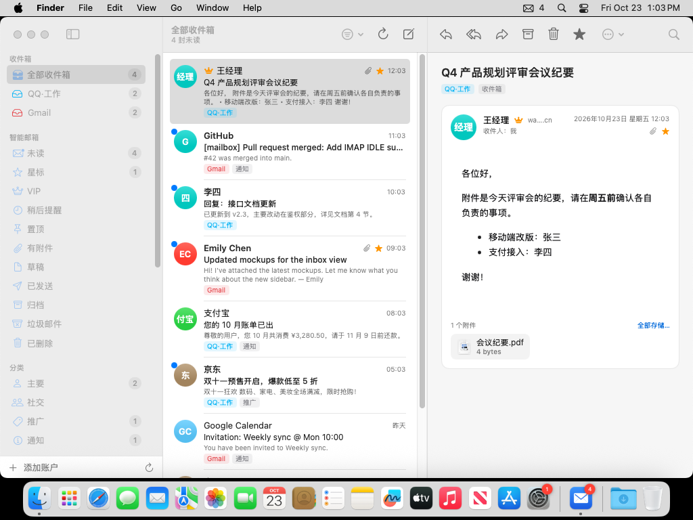
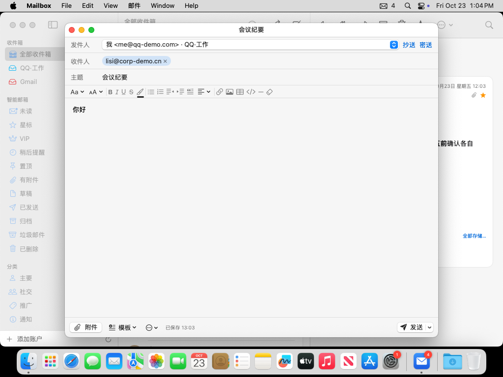
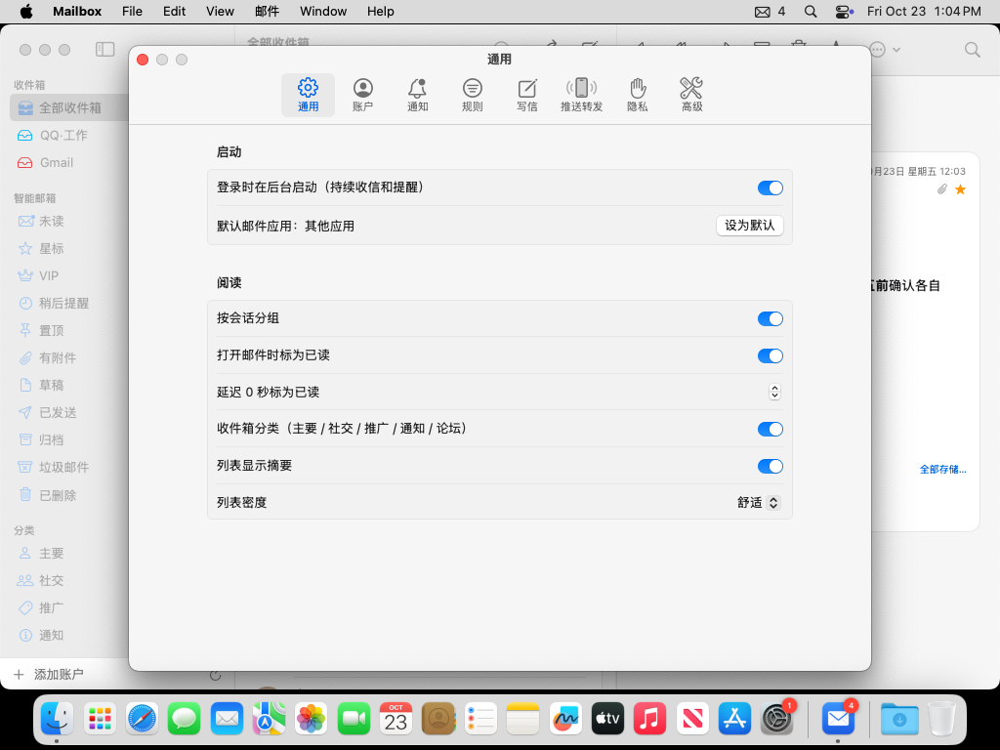
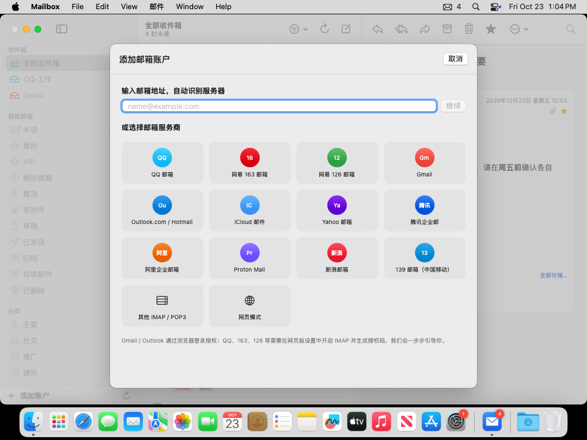

<p align="center"></p>

<h1 align="center">Mailbox</h1>

<p align="center">轻量、简洁的 macOS 聚合邮箱。Gmail、Outlook / Hotmail、QQ、Foxmail、163、126、iCloud、ProtonMail… 一个收件箱全部搞定。</p>

> 这是**无 AI 版**。带 AI 功能（润色、摘要、自动回复、Loop、Claude Code / Codex 订阅接入等）的版本在 [ComeHereToSee/mailbox-ai](https://github.com/ComeHereToSee/mailbox-ai)。



| 写信 | 设置 | 添加账户 |
|---|---|---|
|  |  |  |

<sub>截图由 CI 在 macOS 15 上用演示数据（`--demo`）自动拍摄。</sub>

## 特点

- **原生又轻**：SwiftUI 界面 + Rust 核心。后台 Helper 常驻菜单栏负责收信，主窗口关掉也照常提醒。
- **所有常见邮箱**：内置 33 个服务商预设；其他邮箱可按 MX / ISPDB / SRV 自动识别。支持 IMAP（含 IDLE 实时推送）、POP3 和 SMTP。
- **登录省心**：
  - Gmail / Outlook 在你的默认浏览器里登录，就像在 Chrome 里登录一样。
  - QQ / 163 / 126 有内置浏览器，一步步引导你开启 IMAP、生成授权码。
  - 还有“网页模式”，任何网页邮箱都能嵌进来当一个账户用。
- **提醒注明账户**：通知标题形如 `[QQ·工作] 张三`。可以直接在通知里回复、标为已读、归档或删除。
- **完整收发**：
  - 富文本编辑（字体、颜色、列表、表格、图片、链接），也有 Markdown 和纯文本模式。
  - 收件人、抄送、密送，联系人自动补全。
  - 回复、全部回复、转发、作为附件转发。
  - 撤销发送、定时发送、模板、多身份签名、已读回执。
- **高效处理**：
  - 统一收件箱、会话视图、收件箱分类（主要 / 社交 / 推广 / 通知 / 论坛）。
  - 星标、置顶、稍后提醒、标签、规则、VIP。
  - 一键退订、屏蔽发件人、撤销操作，以及 Gmail 风格快捷键。
- **搜索**：本地全文搜索，中文按双字切分；支持 `from:` `has:attachment` `before:` 等语法；可保存为智能文件夹，也可以做服务器端搜索。
- **系统集成**：
  - 会议邀请可以接受、暂定或拒绝，并加入日历；邮件可以生成提醒事项。
  - 分享扩展、服务菜单，可设为默认邮件应用。
  - Spotlight 搜索、快捷指令、Touch ID 锁。
- **推送到手机 / 聊天工具**：Bark（iPhone）、Server酱 / PushPlus（微信）、企业微信、飞书、钉钉、Telegram、ntfy，或自定义 Webhook。
- **隐私**：
  - 默认拦截远程图片和跟踪像素，链接与显示地址不一致时会提示。
  - 凭据加密保存，主密钥放在钥匙串里。
  - 不经过任何第三方服务器。

## 安装

1. 在仓库的 Actions 页面（或 Releases）下载 `Mailbox.dmg`，把 Mailbox 拖进“应用程序”。
2. 应用没有开发者签名，第一次打开需要二选一：
   - 在 Finder 里**右键 Mailbox → 打开**；
   - 或者在终端执行 `xattr -dr com.apple.quarantine /Applications/Mailbox.app`。
3. 首次启动后会出现 **Mailbox Helper** 的通知授权弹窗，请选择“允许”。
4. 想登录时自动在后台收信：设置 → 通用 → “登录时在后台启动”。

各邮箱的登录方法见 [docs/guides](docs/guides/)：

| 邮箱 | 说明 |
|---|---|
| QQ / Foxmail / 腾讯企业邮 | [授权码](docs/guides/qq.md) |
| 163 / 126 / yeah / 188 | [授权码](docs/guides/netease.md) |
| Gmail | [OAuth 客户端或应用专用密码](docs/guides/gmail.md) |
| Outlook / Hotmail / Office 365 | [OAuth 客户端](docs/guides/outlook.md) |
| iCloud | [App 专用密码](docs/guides/icloud.md) |
| ProtonMail | [Proton Mail Bridge](docs/guides/proton.md) |
| 推送到手机 | [Bark / Server酱 / 企业微信 …](docs/guides/push.md) |

## 自己构建

需要 macOS 14+、Xcode 16+、Rust（rustup）和 XcodeGen：

```bash
brew install xcodegen
scripts/build-macos.sh          # 生成 dist/Mailbox.dmg
# 只构建本机架构，速度更快：
ARCHS=arm64 scripts/build-macos.sh
```

## 架构

```
Mailbox.app（SwiftUI）  ──HTTP/WebSocket（127.0.0.1 + token）──┐
Contents/Library/LoginItems/MailboxHelper.app                    │
   ├─ 菜单栏迷你收件箱、系统通知                                  │
   └─ libmailcore.a（Rust）◀──────────────────────────────────────┘
        ├─ IMAP / POP3 / SMTP / OAuth2 / 自动发现
        ├─ 同步引擎（IDLE、增量、离线操作队列、撤销）
        ├─ SQLite + FTS5（中文双字切分）
        └─ 规则、分类、日历邀请、推送转发
```

- `core/`：Rust 工作区
  - `mailcore`：引擎库
  - `mailcore-ffi`：给 Helper 用的 C 接口
  - `mailboxd`：无界面守护进程，开发和测试用
- `macos/`：Xcode 工程（XcodeGen），包含 Mailbox、MailboxHelper、ShareExtension 三个目标
- 本地 API 见 [docs/API.md](docs/API.md)，需求基线见 [docs/REQUIREMENTS.md](docs/REQUIREMENTS.md)

## 测试

协议层用真实的邮件服务器做集成测试：

```bash
scripts/test-env/start.sh       # 启动 Dovecot（IMAP/POP3）+ GreenMail（SMTP）
cd core && MAILBOX_TEST_SERVERS=1 cargo test
```

CI 在 Linux 上跑核心测试，在 macOS 上构建 App 和 DMG。
